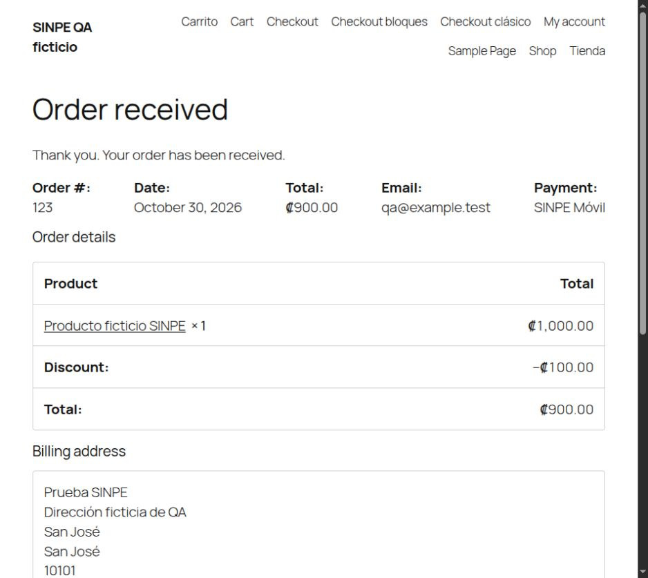
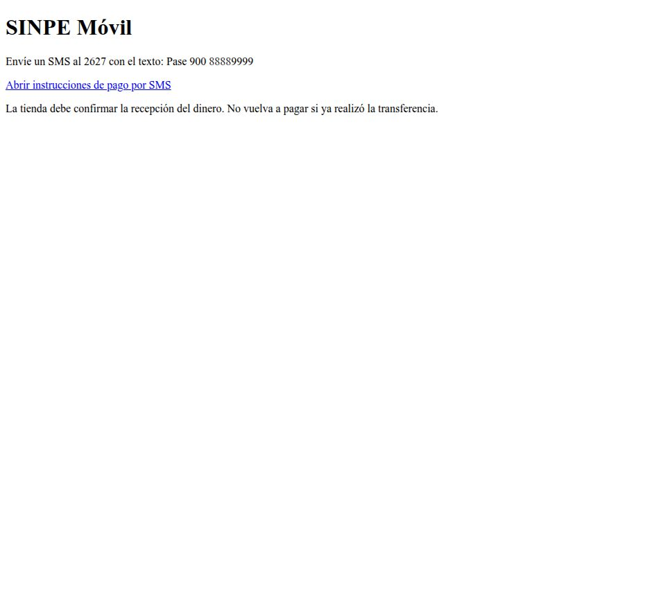

# QA de Mojito Sinpe 1.3.0

Fecha: 30 de octubre de 2026, America/Costa_Rica.
Base: `master` / `feae4da`; rama `codex/update-sinpe-1.3.0`.
Candidato de revisión; no publicado, fusionado ni instalado en tiendas de clientes.

## Matriz funcional local

Se usaron bases MySQL 8.0 privadas en `/tmp`, con pedidos/productos/clientes ficticios, envío de correo interceptado y sin enviar SMS ni fondos. Cada fila se ejecutó con CPT y HPOS; en los casos HPOS la sincronización permaneció desactivada. Antes de cambiar el almacenamiento se sincronizaron exclusivamente los datos ficticios para cumplir las restricciones de WooCommerce.

| WordPress | WooCommerce | PHP probado | Casos CPT/HPOS |
|---|---|---|---|
| 6.2.15 | 8.2.3 | 8.2.35 | 2 |
| 6.7.8 | 9.5.2 | 8.2.35, 8.3.36, 8.4.26 | 6 |
| 7.1.4 | 11.2.1 | 8.2.35, 8.3.36, 8.4.26, 8.5.12 | 8 |
| 7.2-beta2 | 11.3.0-beta.1 | 8.5.12 | 2 anticipados |

Resultado: **16 combinaciones estables, 768 comprobaciones**, más **2 combinaciones preliminares, 96 comprobaciones**. Las versiones preliminares no se anuncian como soporte estable.

Las comprobaciones cubren la clave real de configuración, registro de bloques y carga tardía, validación de banco/comprobante, instantáneas de importes previas al correo, estados, lectura desde almacenamiento real, reintentos, recuperación de bloqueo vencido, stock, clientes registrados/invitados, pasarela desactivada, cotización fija, invalidación y regeneración administrativa, claves de pedido, correos HTML/texto y actualizaciones de cantidad en Store API. En HPOS se consultó además la fila física de `wc_orders_meta`.

Los casos de concurrencia comprueban rechazo de un bloqueo activo y recuperación de una concesión vencida; no constituyen una prueba de carga con múltiples procesos simultáneos.

## Navegador y actualización

- Navegador Chromium de escritorio, WordPress 7.1.4 / WooCommerce 11.2.1 / PHP 8.4.26, con HPOS.
- Checkout de bloques: banco y comprobante, cupón de 10%, monto/SMS de 1000 a 900 CRC, pedido recibido por 900 CRC e instrucciones protegidas.
- Checkout clásico: mismo cupón, conservación de banco/comprobante durante AJAX, monto/SMS 900 CRC y pedido recibido.
- Instrucciones posteriores al pedido traducidas al español; no se abrió ninguna aplicación de SMS.
- URLs amigables: checkout resuelve, instrucciones autorizadas mantienen el monto y las cabeceras de privacidad; clave incorrecta devuelve 403, sin destinatario y con `no-store`.
- WordPress Multisite: WooCommerce/SINPE activados en red; pasarela registrada tanto en el sitio principal como en un subsitio ficticio.
- Actualización real desde el ZIP público **1.2.0** al candidato **1.3.0** en una cuarta tienda ficticia: configuración exacta preservada (incluida clave personalizada), metadatos de pedidos anteriores conservados, CRC legible, USD sin tasa histórica solicita regeneración. La instalación funciona sin `vendor` ni Composer en producción.

## Controles y paquete

- Lint PHP; PHPStan nivel 5 con stubs mantenidos y sin baseline; WordPress-Core; PHPCompatibilityWP; validación estricta de Composer.
- 38 regresiones aisladas de importes/HTTP/SMS ejecutadas en cada PHP 8.2–8.5.
- 11 pruebas JavaScript de disponibilidad, transmisión de datos, validación, recálculo, estado de carga, opciones y URI Android/iOS.
- Plugin Check oficial sobre el contenido extraído del ZIP: **sin errores ni avisos**. El paquete se verifica separado del repositorio de desarrollo.
- `composer audit --locked`: sin avisos de vulnerabilidad ni paquetes abandonados en la consulta realizada.
- Dos compilaciones producen un ZIP idéntico, con 27 archivos de producción y manifiesto SHA-256 externo. No se distribuyen herramientas ni dependencias de desarrollo.
- SHA-256 del candidato: `9d57a90fdf69a5ffb2e7887dc39b4cebc8f27bcab7a43ef8533239429a9583b3`.
- PHPCompatibilityWP 3.0.0-alpha2 / PHPCompatibility 10.0.0-alpha2 se fijan exclusivamente como herramientas de desarrollo: la versión estable anterior 9.3.5 no cubre de forma suficiente PHP 8.x. No cambian dependencias de producción.

Los entornos antiguos WooCommerce 9.5.2/PHP 8.4 y la herramienta local WP-CLI/PHP 8.5 generan avisos de obsolescencia upstream; sus rutas se conservaron en los registros. No se atribuyen al plugin ni se ocultan mediante una baseline. Las pruebas exitosas no significan que esas versiones antiguas reciban soporte de seguridad.

## Límites y condiciones de publicación

1. Validación física Android/iPhone pendiente: las pruebas de URI y de navegador no prueban envío/aceptación bancaria.
2. Completar la verificación oficial de los números heredados y comandos de cada entidad: ver [catálogo bancario](bank-catalog.md). No se inventaron números nuevos.
3. No se probaron fondos reales, entrega externa de correo, todos los temas/extensiones ni un escenario de carga.
4. La edición del bloque en el editor visual requiere revisión manual adicional; la integración y los datos de vista previa tienen controles automatizados.
5. CI remoto confirmado en `c3896d4`: [ejecución 41149048983](https://github.com/mojitowp/sinpe/actions/runs/41149048983), 13 trabajos correctos, incluidos betas y Plugin Check. Revalidar ante cambios posteriores; los resultados locales no sustituyen CI.
6. La publicación en WordPress.org y el merge requieren autorización independiente. El ZIP es un candidato de revisión.

Fuentes de plataformas: [WordPress 7.1.4](https://wordpress.org/news/2026/10/wordpress-7-1-4/), [WooCommerce 11.2.1](https://developer.woocommerce.com/2026/10/09/woocommerce-11-2-1-release-notes/), [WordPress 7.2-beta2](https://wordpress.org/news/2026/10/wordpress-7-2-beta-2/), [beta WooCommerce](https://github.com/woocommerce/woocommerce/releases/tag/11.3.0-beta.1), [soporte PHP](https://www.php.net/supported-versions.php).
